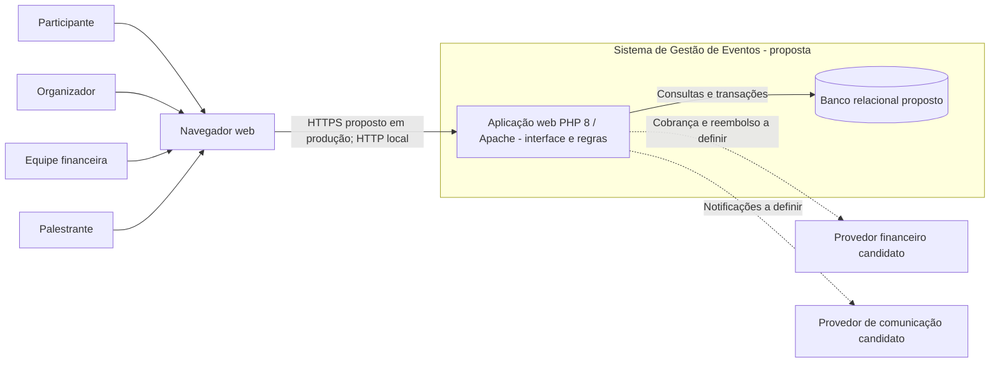
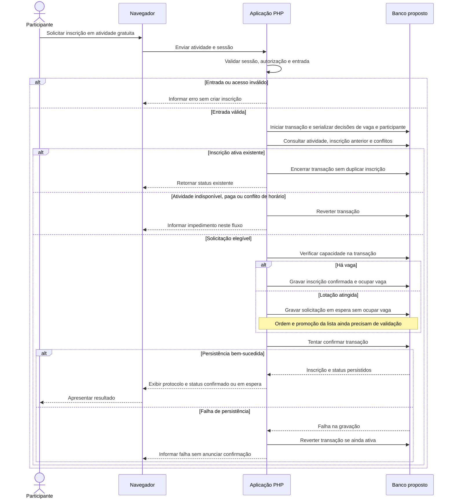

# Sistema de Gestao de Eventos

Projeto academico baseado no caso da empresa Eventos, que organiza congressos, workshops e eventos corporativos. A proposta centraliza eventos, inscricoes, vagas, pagamentos, cancelamentos, reembolsos e certificados.

## MVP executavel

O prototipo em PHP permite consultar eventos, visualizar disponibilidade e simular uma inscricao ou entrada em lista de espera. Os eventos sao arrays fixos: nao ha persistencia, atualizacao de vagas, envio de comprovantes ou integracao financeira. Fluxos financeiros, cancelamentos e certificados permanecem no escopo documentado, mas dependem da validacao das regras em aberto.

## Stakeholders

Participantes, organizadores, equipe financeira, palestrantes e equipe de TI.

## Como executar

1. Inicie o Apache no XAMPP.
2. Acesse `http://localhost/projeto/projeto_akcit/`.

## Testes

```powershell
C:\xampp\php\php.exe tests\test_conf.php
C:\xampp\php\php.exe tests\test_eventos.php
```

Ou use `make test`. Para validar sintaxe, use `make lint`.

## Artefatos

- [Contexto do projeto](docs/project_management.md)
- [Identificacao de riscos](docs/risks/identification.md)
- [Analise qualitativa](docs/risks/analysis.md)
- [Respostas aos riscos](docs/risks/response.md)
- [Comunicacao com stakeholders](docs/comunicacao-stakeholders.md)

## Regras ainda pendentes de validacao

Prazo de cancelamento; situacoes de reembolso; funcionamento da lista de espera; momento de reserva da vaga; criterio de emissao de certificado; canais de comprovantes e notificacoes; dados visiveis aos palestrantes; e metas nao funcionais.

## Estrutura

```text
README.md
docs/
  project_management.md
  comunicacao-stakeholders.md
  risks/
projeto_akcit/
  index.php
  eventos.php
tests/
  test_conf.php
  test_eventos.php
```

## Uso de IA generativa

A IA apoiou a analise, estruturacao e revisao dos artefatos. As sugestoes devem ser validadas pelos stakeholders antes de transformar lacunas em regras definitivas.

## Unidade III — Discovery com diagrams as code

### 1. Sistema escolhido e fontes

Este discovery utiliza o **Sistema de Gestão de Eventos** já existente neste repositório. A empresa organiza congressos, workshops e eventos corporativos e pretende substituir controles em formulários e planilhas por uma aplicação centralizada.

Fontes: [contexto](docs/project_management.md), [histórias US01–US17](requisitos_salas_estudo/especificacao/01_historias_usuario.md), [regras de negócio](requisitos_salas_estudo/analise/regras_de_negocio.md), [lacunas](requisitos_salas_estudo/analise/ambiguidades_lacunas.md) e código em [index.php](projeto_akcit/index.php) e [eventos.php](projeto_akcit/eventos.php). Apesar do nome histórico da pasta de requisitos, seu conteúdo descreve gestão de eventos.

O [repositório do projeto](https://github.com/danieleesl/akcit_miniprojeto) é público e concentra o protótipo e a documentação desta atividade.

### 2. Escopo, nível da visão e limites

O escopo de negócio inclui catálogo, inscrições, vagas, lista de espera, pagamentos, cancelamentos, reembolsos, comprovantes, notificações e certificados. Participantes gerenciam suas inscrições; organizadores gerenciam eventos e capacidade; a equipe financeira acompanha pagamentos e reembolsos; palestrantes consultam participantes das próprias atividades.

A visão estrutural é uma **proposta de containers inspirada no C4**, não um inventário de componentes já implantados. Uma aplicação PHP concentra interface e regras de negócio; um banco relacional proposto armazena os dados. O diagrama comportamental detalha uma jornada futura de inscrição em atividade gratuita. Assim, esta documentação descreve a evolução pretendida, enquanto o código atual apenas simula o resultado de uma inscrição.

O sistema será responsável por autorização, inscrições e consistência de vagas. Provedores externos, se adotados, processarão pagamentos e entregarão notificações; a aplicação continuará responsável por conciliar resultados. Fornecedores e contratos não estão definidos. Aplicativo móvel nativo, transmissão de eventos, contabilidade completa e implementação dos serviços externos ficam fora deste recorte.

### 3. Restrições, propostas e divergências

| Classificação | Registro | Consequência |
|---|---|---|
| Restrição existente | MVP web em PHP 8 e XAMPP | Preservar compatibilidade; hospedagem de produção ainda em aberto. |
| Restrição existente | Controle de acesso, privacidade e rastreabilidade | Especificar permissões, retenção e auditoria antes de uso operacional. |
| Proposta arquitetural | Aplicação única e banco relacional | Simplificar o primeiro incremento; SGBD e esquema ainda pendentes. |
| Proposta de consistência | Inscrição e ocupação da vaga na mesma transação | Evitar confirmações concorrentes para a última vaga. |
| Hipótese da sequência | Participante autenticado e atividade gratuita | Autenticação ainda não existe no protótipo; pagamento exige outro fluxo. |
| Divergência de fontes | O contexto bloqueia sobreposição; RN-13 permite política por evento | A sequência assume bloqueio como hipótese do recorte; validar a política definitiva. |
| Divergência de fontes | RN-05 propõe FIFO com exceções; contexto e lacunas mantêm a ordem em aberto | Não considerar FIFO aprovado; validar ordenação e promoção. |
| Regra a validar | RN-17 prevê unicidade com possível exceção | A sequência assume uma inscrição ativa por participante e atividade. |

### 4. Diagrama estrutural — arquitetura proposta

Os blocos Mermaid são o código-fonte dos diagramas, renderizável na visualização deste README no GitHub. Linhas tracejadas representam integrações candidatas. Banco e provedores ainda não existem no protótipo.



O navegador está fora da fronteira do servidor. A aplicação concentra os módulos de negócio; eles não são serviços independentes. O banco deverá armazenar eventos, atividades, inscrições e registros financeiros. XAMPP é o ambiente local, não uma decisão de hospedagem de produção. No código existente, `index.php` chama funções de `eventos.php` que trabalham com arrays em memória.

### 5. Diagrama comportamental — inscrição gratuita

Jornada relacionada a US01, US02, US03, US07, US10 e US12. Pré-condições propostas: participante autenticado e atividade publicada e gratuita. O recorte assume bloqueio de conflito de horários e unicidade de inscrição; ambas as políticas precisam de validação conforme as divergências acima. Sucesso significa inscrição persistida e vaga ocupada atomicamente; lista de espera não ocupa vaga.



Qualquer falha de acesso ao banco interrompe a jornada sem anunciar sucesso. A serialização deve proteger tanto a última vaga quanto inscrições simultâneas do mesmo participante em horários conflitantes; bloqueios, isolamento e idempotência dependem do SGBD e precisam ser especificados. O protocolo em tela é uma proposta de retorno imediato, não substitui a definição do comprovante e de seu canal. Timeout com resultado incerto e novas tentativas também exigem contrato próprio.

### 6. Uso de GenAI e ajustes

A IA foi usada para analisar os arquivos e elaborar os diagramas desta entrega. As decisões abaixo são propostas para revisão acadêmica, não aprovações de stakeholders. A revisão humana do aluno ainda deve confirmar ou alterar estas escolhas.

Prompt de referência para reproduzir e refinar a geração:

> Use o contexto, as histórias, as regras de negócio e o protótipo PHP do Sistema de Gestão de Eventos. Gere em Mermaid uma visão de containers inspirada no C4 e uma sequência de inscrição em atividade gratuita. Separe o estado atual da arquitetura proposta. Explicite limites, integrações opcionais, restrições, divergências entre fontes e lacunas. Considere lotação, duplicidade, conflito de horários e falha de persistência. Não invente políticas financeiras, de lista de espera ou de certificados. Explique as decisões que precisam de revisão humana.

| Inferência ou ponto revisado | Tratamento e justificativa |
|---|---|
| Perfis e centralização de inscrições identificados corretamente | Mantidos porque constam no contexto e nas histórias US01–US17. |
| Persistência necessária para controlar vagas reais | Banco proposto, deixando explícito que não existe no protótipo. |
| A mensagem do protótipo sugeria inscrição efetiva | Corrigida a descrição inicial do README: a função apenas retorna dados e mensagem, sem gravar inscrição. |
| Requisitos financeiros poderiam ser confundidos com integração existente | Provedores apresentados como candidatos, sem escolher fornecedor ou protocolo. |
| Confirmação imediata seria ambígua em evento pago | Jornada delimitada a atividade gratuita; reserva de vaga paga permanece em aberto. |
| Regras de horário e fila não são uniformes nas fontes | Divergências documentadas e hipóteses da sequência declaradas. |

Não foi arquivada uma versão anterior dos diagramas nesta elaboração; a tabela registra a revisão das inferências contra as fontes, sem inventar um histórico de respostas do modelo. Evoluções posteriores devem preservar os motivos das alterações no Git.

Decisões arquiteturais propostas: **D01**, manter aplicação única para reduzir complexidade operacional no MVP; **D02**, adotar persistência relacional com transações para manter inscrições e vagas consistentes; **D03**, deixar integrações externas condicionais até validar contratos. D01 concentra responsabilidades em um deploy; D02 exige escolha de SGBD, migrações e recuperação; D03 mantém os fluxos externos incompletos até sua especificação.

### 7. O que falta para um agente implementar sem inventar decisões

| Lacuna | Definição necessária | Validação sugerida |
|---|---|---|
| Inscrição e lista de espera | Estados, transições, ordem, promoção, expiração e exceções de unicidade | Organização |
| Conflitos de horário | Resolver divergência entre bloqueio obrigatório e política por evento | Organização |
| Pagamentos e reembolsos | Reserva da vaga, confirmação, prazos, falhas e conciliação | Organização e financeiro |
| Certificados e comprovantes | Elegibilidade, presença, conteúdo, momento de emissão e canal de entrega | Organização |
| Identidade e privacidade | Login, matriz de permissões, retenção, exclusão e campos visíveis a palestrantes | Organização e TI |
| Dados e concorrência | SGBD, esquema, chaves, isolamento, idempotência e auditoria | TI |
| Integrações | Fornecedores, contratos, autenticação, retornos e retentativas | TI e financeiro |
| Qualidade e operação | Metas de desempenho, disponibilidade, acessibilidade, backup e implantação | Organização e TI |
| Critérios verificáveis | Revisar critérios de aceitação e definir operações, erros e testes | TI e usuários |

Um agente deve implementar apenas recortes com regras aprovadas e registrar bloqueios quando faltar uma decisão. Exemplos de testes futuros: somente uma confirmação para a última vaga; reenvio sem duplicidade; bloqueio de sobreposição conforme política aprovada; falha de gravação sem confirmação ao usuário. Os diagramas não substituem contratos de operações ou critérios de aceitação.

### 8. Texto-base para o fórum

Texto sugerido para revisão e postagem pelo aluno:

> Repositório: https://github.com/danieleesl/akcit_miniprojeto
>
> Usei o Sistema de Gestão de Eventos, um projeto que já vinha desenvolvendo, para documentar uma visão estrutural e a jornada de inscrição gratuita com Mermaid. A IA identificou corretamente os perfis de usuários e a centralização de inscrições e vagas. Na elaboração, foi necessário explicitar que o protótipo apenas simula inscrições, separar a arquitetura proposta do código existente e registrar divergências nas regras de horários e lista de espera. Para um agente implementar o sistema sem inventar decisões, ainda faltam políticas de inscrição e pagamento, modelo de dados, contratos de integração, permissões e metas não funcionais verificáveis.

### 9. Visita a colega e sugestão preparada

Foram consultados os READMEs de [Gerador de Senhas CLI](https://github.com/miesper/akcit_genai_password_generator) e [Simula Crédito](https://github.com/walmunsan-cloud/simula-credito-arquitetura). O primeiro organiza documentação de arquitetura em `docs/C11`; o segundo apresenta os dois diagramas no README e registra decisões de aplicação única e ausência de banco no recorte inicial.

Sugestão para comentar no projeto **Simula Crédito**:

> A delimitação do escopo acadêmico e a decisão de manter uma aplicação única deixam a proposta clara. Sugiro acrescentar um bloco `alt` ao diagrama de sequência para entradas inválidas, como prazo zero ou renda negativa, indicando a resposta da API. Também ajudaria documentar a fórmula da parcela e os critérios de arredondamento: isso reduziria decisões que um agente precisaria inferir ao implementar.

Este comentário está apenas preparado; ainda precisa ser publicado pelo aluno no espaço de participação do colega. Antes da entrega, conferir os dois diagramas renderizados no GitHub.
